# 03 — Data model

The prototype's domain model lives in `src/types/index.ts`. This document explains it for backend developers. The proposed relational schema is `04-database-schema.sql`, and the API that exposes it is `05-api-contract.yaml`.

All data in the prototype is fictional and stored in one `AppState` object in the browser's localStorage (`src/store/DataProvider.tsx`). In production every collection in `AppState` becomes a table, or a set of tables, behind an API.

## Modeling principles

1. **Stable internal IDs.** Every entity has an opaque internal `id`. Nothing is keyed by an external identifier: not by CMS provider number (CCN), license number or name.
2. **External identifiers are time-bounded.** A CMS CCN follows the *operator's Medicare certification*, not the physical property. After a change of ownership (CHOW) a building can get a new CCN. `BuildingIdentifier` records carry `effectiveFrom` / `effectiveTo` / `isCurrent`, and editing a CCN retires the old one rather than overwriting it. Brookhaven and Chestnut Hill in the seed data each have a prior CCN.
3. **A Building is permanent facility intelligence.** It outlives any deal. Deal-specific values, such as price allocation or a building's role in a transaction, live on `DealBuildingRelationship`, never on `Building`. One building can be in many deals (Seaside Pines is in a dead 2024 deal and an active 2026 deal).
4. **Provenance and verification on key facts.** Bed counts, census, year built and square footage are `Tracked<T>` values: the value plus a `SourceMeta` record (`source`, `asOf`, `verification`, `verifiedBy`, `note`). The UI shows a colored dot per field, and the Overview's Attention panel lists unverified fields. Editing a value resets its provenance to `manual`.
5. **History over overwrite.** Ownership changes, CCN changes, document versions, checklist events and activities are appended, not replaced.

## Entities

### Building

| Field | Notes |
|---|---|
| `id` | Internal ID |
| `name`, `alternateNames[]` | Alternate names support search and deduplication |
| `facilityType` | `skilled_nursing` \| `assisted_living` \| `memory_care` \| `ccrc` \| `behavioral_health` |
| `address` | street, city, state (USPS), zip, county. **`mapX`/`mapY` are prototype-only** (placeholder map); replace with geocoded `latitude`/`longitude` |
| `identifiers[]` | `BuildingIdentifier` (see below) |
| `certifiedBeds`, `licensedBeds`, `averageDailyCensus`, `yearBuilt`, `squareFeet` | `Tracked<number>`: value + `SourceMeta` |
| `stories`, `acreage`, `privateRooms`, `semiPrivateRooms` | Plain nullable numbers |
| `verificationStatus`, `lastVerifiedAt` | Overall verification shown in the directory |
| `photos[]` | `BuildingPhoto`; first photo is the cover. **`dataUrl` is prototype-only** (downscaled images stored in localStorage); replace with object storage keys and URLs |
| `photoSeed` | **Prototype-only**: seeds the generated illustration. Drop it |
| `tags[]`, `createdAt`, `updatedAt`, `createdBy` | Audit and tags |

**BuildingIdentifier**: `type` (`cms_ccn` \| `state_license` \| `npi` \| `medicaid_id`), `value`, `issuer`, `effectiveFrom`, `effectiveTo?`, `isCurrent`, `note`. A building can have many identifiers of the same type over time, but only one current identifier per type.

**Derived values (not stored):** occupancy (`ADC ÷ certified beds`) and document completion stats (`store/selectors.ts → docStats`).

### Organization (company)

| Field | Notes |
|---|---|
| `type` | **Role in the ecosystem**: `owner` \| `operator` \| `parent` \| `management` \| `broker` \| `lender` \| `law_firm` \| `consultant` \| `investor` |
| `companyType` | **Capital classification** (CRM "Company Type" dropdown): `bank` \| `finco` \| `mezz_lender` \| `reit` \| `private` \| `ar_lender`. Independent of `type`; for example, a bank can be a lender on one building and the owner (REO) of another |
| `parentOrgId` | Self-reference |
| `hqCity`, `hqState`, `officeAddress` | `officeAddress` is the full CRM address; `hq*` is kept for list display |
| `acuityFocus[]`, `regionalFocus[]`, `stateFocus[]` | Multi-select pick lists (`ACUITY_OPTIONS`, `REGION_OPTIONS`, USPS codes) |
| `primaryContactId` | Contact shown first on the Owner tab and marked with a star |
| `logoDataUrl` | **Prototype-only** image storage; replace with object storage |
| `website`, `description`, `tags[]` | |

### Contact

| Field | Notes |
|---|---|
| `organizationId` | Required. Every contact belongs to exactly one company |
| `contactType` | `operator` \| `vendor_dd` \| `vendor_operating` \| `investor` \| `broker` \| `lawyer` (labels: Operator, Vendor (Due Diligence), Vendor (Operating), Investor / Capital Provider, Broker, Lawyer) |
| `sectors[]` | One or more of `snf` \| `alf` \| `ilf` \| `mc` |
| `email`, `phone` | Work email and office phone |
| `mobilePhone`, `linkedIn` | |
| `dob`, `personalEmail`, `mailingAddress` | **Personal data.** Visible to all users in the prototype; role-based visibility is required in production |
| `rosterRole`, `notes`, `tags[]` | Corporate roster columns |
| `photoDataUrl` | **Prototype-only** image storage |

Defaults when a contact is created: `contactType` and `sectors` are derived from the company (`src/data/contactDefaults.ts`). The user can change both.

### BuildingOwnership (time-bounded)

`buildingId`, `organizationId`, `role` (`property_owner` \| `operator` \| `parent_organization` \| `management_company`), `startDate`, `endDate?`, `isCurrent`, `meta: SourceMeta`, `note`.

- At most one *current* record per (building, role).
- **Change owner** closes the current `property_owner` record (`isCurrent=false`, `endDate=effectiveDate`) and inserts a new one.
- The building's "current owner / operator / parent / management" is derived from the current records.

### BuildingRelationship

Non-ownership links between a building and a company and/or contact: `role` (`broker` \| `lender` \| `attorney` \| `consultant` \| `key_contact` \| `administrator` \| `other`), `organizationId?`, `contactId?`, `description`, `since`. These feed the Relationships tab, the Overview's key contacts and a contact's related buildings.

### Deal

| Group | Fields |
|---|---|
| Identity | `id`, `name`, `code` (`OD-YYYY-NNN`; `MKT-…` = recorded market comp, excluded from the pipeline by default), `type` (`single_asset` \| `portfolio`) |
| Milestone | `stage` (`high_level_review` → `loi_signed` → `psa_signed` → `closed` → `asset_management`), `status` (`active` \| `closed` \| `dead` \| `abandoned`), `skippedLoi`, `deadReason` |
| Parties | `sellerOrgId`, `brokerOrgId`, `lenderOrgId`, `buyerOrgId`, `buyerEntity` (legal entity text), `sourceOrgId`, `sourceContactId`, `currentOperatorOrgId` (defaults to operators of the deal's buildings), `newOperatorOrgId`, `jvPartnerOrgId`, `jvPct` |
| Economics | `askingPrice`, `purchasePrice`, `projectedCloseDate`, `actualCloseDate` |
| Classification | `dealKind` (`acquisition` \| `sale_leaseback` \| `joint_venture` \| `recapitalization` \| `refinance` \| `disposition`), `assetClass` (`snf` \| `alf` \| `ilf` \| `mc` \| `ccrc` \| `mixed`) |
| Overrides | `statesOverride[]`, `totalBuildingsOverride`, `totalLicBedsOverride`: used when not every building is in Owner Docket yet; otherwise calculated |
| Team | `contacts[]`: `DealContactAssignment` (see below); `buyerDistribution`, `sellerDistribution` (semicolon-separated email catch-alls) |
| Diligence | `reports[]`: `ThirdPartyReport`; `dataRoomUrl` |
| Progress | `checklist[]` (see below), `phaseOverrides` (pipeline-phase manual ticks), `dealApproverContactId`, `autoAdvance`, `milestoneFloor`, `lastAutoAdvance` |
| Other | `leadName`, `summary`, `createdAt`. **`progress` is a legacy, unused field** from an earlier starter checklist; drop it |

**Calculated (not stored):** total buildings, total licensed beds, states, asking price per bed (`askingPrice ÷ total licensed beds`) and overall progress (`store/selectors.ts → dealView`, `lib/checklist.ts → checklistProgress`).

**DealContactAssignment**: `{ side: "buyer" | "seller", role: BuyerSellerRole, contactId }` or `{ side: "vendor", role: VendorRole, contactId }`. There is one contact per (deal, side, role).
- Buyer/seller roles: `team_lead`, `support_1`, `support_2`, `in_house_counsel`, `transaction_counsel`, `financing_counsel`, `regulatory_counsel`.
- Vendor roles: `survey`, `title`, `zoning`, `environmental`, `property_condition`, `appraisal`, `reimbursement`, `operations`.

**ThirdPartyReport**: one per vendor role (`kind`), with `status` (`not_ordered` \| `ordered` \| `in_progress` \| `draft_received` \| `final_received` \| `waived`), `dateOrdered`, `expectedDate`, `url`.

### DealBuildingRelationship

`dealId`, `buildingId`, `role` (`primary_asset` \| `portfolio_asset` \| `add_on` \| `excluded`), `priceAllocation`, `allocationBasis`, `notes`, `addedAt`. Unique on (deal, building).

### Deal checklist (Progress tab)

```
Deal 1─* DealChecklistItem 1─* ChecklistStage 1─* ChecklistSubItem
                          1─* ChecklistDoc
                          1─* ChecklistEvent (history)
```

**DealChecklistItem**

| Field | Notes |
|---|---|
| `key` | Template key, e.g. `deal_sourced`, `psa_loi`; 19 items, from `CHECKLIST_TEMPLATE` in `src/lib/checklist.ts` |
| `stages[]` | Ordered stages |
| `responsibleContactId`, `approverContactId` | An empty `approverContactId` means the deal approver applies |
| `requiresResponsible`, `requiresDocument` | Both false for PSA LOI |
| `approval` | `{ status: pending\|approved, by, at, note }` |
| `documentWaived` | `{ reason, by, at }` |
| `documents[]` | `ChecklistDoc` |
| `bypass` | `{ reason, by, at }`: item is "not needed for this deal" and excluded from progress |
| `history[]` | `ChecklistEvent` |

**ChecklistStage**

| Field | Notes |
|---|---|
| `title` | |
| `status` | `todo` \| `done` \| `skipped` |
| `auto` | System rule that completes the stage: `deal_created`, `has_buildings`, `has_dataroom`, `vendors_engaged`, `reports_drafts`, `reports_finals`, `transitioned_to_am` |
| `subItems[]` | `todo` \| `done` \| `na` |
| `completedByApproval` | The stage is completed by the approver's sign-off (PSA LOI's last stage) |
| `completedAt`, `completedBy`, `skipReason` | |

**ChecklistDoc**: `name`, `size`, `mimeType`, `uploadedAt`, `uploadedBy`, `status` (`submitted` \| `approved` \| `rejected`), `reviewedBy`, `reviewedAt`, `reviewNote`. Approved documents appear on the deal's Documents tab ("filed"). File bytes are **not stored** in the prototype; production needs object storage.

**Effective approver** = `item.approverContactId ?? deal.dealApproverContactId`. Only that contact may approve, request changes or revoke. The prototype enforces this in the client; production **must enforce it server-side** against the authenticated user.

Business rules for progress, auto-complete and milestone auto-advance are documented separately (`06-business-rules.md`) and implemented in `src/lib/checklist.ts`.

### CMS data (mock) — one per CMS-certified building

- `providerNumber`
- `ratings`: overall, health, staffing, qualityMeasures, longStayQm, shortStayQm (1–5)
- `staffing`: HPRD by discipline, plus state and national averages and turnover
- `surveys[]`, `deficiencies[]` (tag, category, scope/severity A–L, status), `penalties[]`
- `ratingHistory[]` (quarterly)
- `specialFocusFacility`, `abuseIcon`, `lastRefreshedAt`, `sourceLabel`

In production this is sourced from CMS Provider Data (Care Compare) and keyed by CCN. Store it as snapshots with `retrieved_at`, so history is kept across CCN changes.

### Property condition and capital projects

- **PropertyCondition** (one per building): overall rating, assessor, date, construction, sprinklered (`full`/`partial`/`none`), generator, parking.
- **`systems[]`**: one per `BuildingSystem` (`roof`, `hvac`, `plumbing`, `electrical`, `life_safety`, `elevators`, `interiors`, `site`), each with a rating (`good`/`fair`/`poor`/`critical`), install year, remaining useful life, notes and source.
- **`deferredMaintenance[]`**: priority `immediate`/`short_term`/`long_term`.
- **`renovations[]`**.
- **CapitalProject**: category (a system, `resident_rooms` or `common_areas`), status (`planned`/`in_progress`/`completed`), budget, spent, dates.

### Financials (illustrative)

`BuildingFinancials` (one per building):

- **`periods[]`** (label, periodEnd, revenue, operatingExpenses, EBITDAR, rent, EBITDA, NOI, occupancyPct, source)
- **`payerMix`** (percentages), plus `payerMixAsOf`
- **`debt`** (lender, type, amounts, rate, dates)
- **`capex[]`** (year, amount)

### Site visits

**SiteVisit**: building, optional deal, date, type (`initial_tour` \| `diligence_inspection` \| `pca_walkthrough` \| `asset_review`), `participants[]` (free-text names), summary, and `conditionRatings` (map of system → rating). It has three child collections:
- `observations[]` (severity, system, open/resolved)
- `followUps[]` (title, assignee, due, done)
- `photos[]` (caption, area, fileName; images are placeholders)

### Building documents & due diligence

**DocumentRequest**: building, optional deal, name, `category` (`licenses` \| `property` \| `financial` \| `legal` \| `third_party` \| `capex` \| `site_visit` \| `other`), `required`, `isBaseline` (license and floor plan are created for every building), `requestedFrom`, `reviewer`, `dueDate`, and `status` (`not_requested` \| `requested` \| `received` \| `in_review` \| `approved` \| `rejected` \| `needs_revision`). It has two child collections:
- `files[]` (`DocumentFile`, versioned; source `upload` \| `sharepoint` \| `email`)
- `comments[]` (`ReviewComment`, with action `approved` \| `rejected` \| `needs_revision` \| `status_change` \| `comment`)

**DataRoomConnection**: per building, simulated SharePoint (site, folder, status, last sync, recent files matched to requests).

### Communications

**Communication**: one message or logged interaction. Messages with the same `threadId` form a conversation.

| Field | Notes |
|---|---|
| `channel` | `email` \| `call` \| `meeting` |
| `direction` | `inbound` \| `outbound` |
| `subject`, `body`, `sentAt` | |
| `from`, `to[]`, `cc[]` | Name and email |
| `attachments[]` | Name and size |
| `contactIds[]` | CRM contacts the message is logged against |
| `dealId?`, `buildingId?` | |
| `durationMin` | Calls and meetings |
| `source` | `outlook_sync` \| `manual` |
| `loggedBy` | |

In production, `outlook_sync` rows come from the Microsoft Graph integration. Contacts are matched by email address.

### Activity

Append-only timeline per building: `type` (`building_created`, `building_updated`, `cms_refreshed`, `document_uploaded`, `document_reviewed`, `document_requested`, `deal_associated`, `site_visit`, `verification_changed`, `note`, `data_room_sync`), title, description, actor, timestamp, optional `dealId`. Deal events are written to each building in the deal. A production system would likely add a `deal_id`-scoped feed, or a polymorphic `subject`.

## Prototype-only fields and what replaces them

| Prototype | Replace with |
|---|---|
| `AppState.version` and `migrate()` in `DataProvider.tsx` | Database migrations |
| `Building.photoSeed`, generated illustrations | Real photos in object storage |
| `Address.mapX/mapY`, schematic map | Geocoded lat/lng and a map provider |
| `BuildingPhoto.dataUrl`, `Organization.logoDataUrl`, `Contact.photoDataUrl` | Object storage (S3/Azure Blob) keys plus signed URLs |
| Session-only file bytes (`features/buildings/documents/sessionFiles.ts`) | Object storage for documents |
| `Deal.progress` / `ProgressItem` | Remove (superseded by `checklist`) |
| `*By` fields holding display names (`createdBy`, `completedBy`, `uploadedBy`, `actor` …) | User foreign keys |
| "Acting as" persona (`DataProvider` `actingAs`) | Authenticated user |
| CMS / SharePoint / Outlook mock data | Real integrations |

## Entity-relationship diagram

```mermaid
erDiagram
  ORGANIZATION ||--o{ CONTACT : employs
  ORGANIZATION ||--o{ ORGANIZATION : "parent of"
  ORGANIZATION ||--o| CONTACT : "primary contact"
  BUILDING ||--o{ BUILDING_IDENTIFIER : "has (time-bounded)"
  BUILDING ||--o{ BUILDING_OWNERSHIP : "owned/operated via"
  ORGANIZATION ||--o{ BUILDING_OWNERSHIP : "holds role"
  BUILDING ||--o{ BUILDING_RELATIONSHIP : "linked to"
  ORGANIZATION ||--o{ BUILDING_RELATIONSHIP : ""
  CONTACT ||--o{ BUILDING_RELATIONSHIP : ""
  BUILDING ||--o{ BUILDING_PHOTO : has
  BUILDING ||--o| CMS_SNAPSHOT : "CMS data"
  BUILDING ||--o| PROPERTY_CONDITION : assessed
  BUILDING ||--o{ CAPITAL_PROJECT : has
  BUILDING ||--o| BUILDING_FINANCIALS : has
  BUILDING ||--o{ SITE_VISIT : visited
  BUILDING ||--o{ DOCUMENT_REQUEST : "diligence docs"
  DOCUMENT_REQUEST ||--o{ DOCUMENT_FILE : versions
  DOCUMENT_REQUEST ||--o{ REVIEW_COMMENT : comments
  BUILDING ||--o{ ACTIVITY : timeline
  DEAL ||--o{ DEAL_BUILDING : includes
  BUILDING ||--o{ DEAL_BUILDING : "part of"
  DEAL ||--o{ DEAL_CONTACT : "team (side, role)"
  CONTACT ||--o{ DEAL_CONTACT : assigned
  DEAL ||--o{ THIRD_PARTY_REPORT : orders
  DEAL ||--o{ CHECKLIST_ITEM : progress
  CHECKLIST_ITEM ||--o{ CHECKLIST_STAGE : stages
  CHECKLIST_STAGE ||--o{ CHECKLIST_SUB_ITEM : "sub-items"
  CHECKLIST_ITEM ||--o{ CHECKLIST_DOCUMENT : documentation
  CHECKLIST_ITEM ||--o{ CHECKLIST_EVENT : history
  CONTACT ||--o{ CHECKLIST_ITEM : "responsible / approver"
  ORGANIZATION ||--o{ DEAL : "seller / buyer / broker / lender / JV / operator"
  CONTACT ||--o{ COMMUNICATION_CONTACT : "logged against"
  COMMUNICATION ||--o{ COMMUNICATION_CONTACT : ""
  COMMUNICATION ||--o{ COMMUNICATION_PARTICIPANT : "from/to/cc"
  DEAL ||--o{ COMMUNICATION : about
  DEAL ||--o{ SITE_VISIT : "during"
  DEAL ||--o{ DOCUMENT_REQUEST : "scoped to"
```


